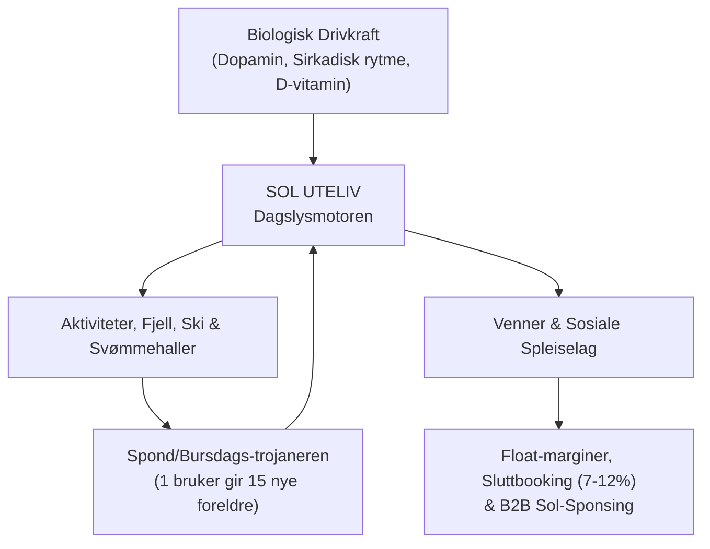

# ☀️ SOL UTELIV — GLOBAL MASTERPLAN
## Fra Norsk Dagslys-Pionér til Internasjonal Kategori-Leder

---

## 0. Executive Summary: Kategoriskaperen
De fleste apper feiler fordi de prøver å være «en ny vær-app» eller «en samling av turløyper». Værapp-markedet er mettet av giganter som Yr, Apple Weather og AccuWeather. Turløyper domineres av UT.no og AllTrails.

**Sol Uteliv konkurrerer ikke mot dem.** Sol Uteliv skaper en helt ny kategori:
> **The Sunlight & Vitality Operating System (Dagslys- og Vitalitetsplattformen).**

Hver eneste nordmann – og senere hver eneste brite, tysker, kanadier og amerikaner i nordlige breddegrader – deler en dypt biologisk besettelse: **Mangel på sollys, utmattelse over skjermtid for barna, og den evige helge-angsten for hva man skal finne på.**

Sol Uteliv kobler biologisk dagslysbehov, hyper-lokale sanntidsaktiviteter, familieøkonomi og vennegjenger sammen i en selvgående, viral vekstmaskin.



---

## DEL 1: Forretningsutvikling & Monetiseringsmaskin

For å bygge et milliard-selskap må inntektsstrømmene være diversifiserte, automatiske og bygget på reell verdi for brukerne og partnere.

### 1.1 Inntektssøyle 1: Sluttbooking & OTA-Kommisjon (Reiseliv & Opplevelser)
* **Kjernemekanikk:** Når en familie eller vennegjeng har nådd sparemålet sitt i **Sol Spleis** (f.eks. 12 000 kr til Lofoten eller 4 500 kr til Geilo), trykker de på «Book Reiser & Opplevelser».
* **Partneravtaler:**
  - DNT (hytter og medlemskap): 10 %
  - Vy / Widerøe / SAS (transport): 2–5 %
  - Booking.com / Airbnb / Norske Hoteller: 8–14 %
  - Aktivitetsarrangører (Høyt & Lavt, Trolljeger, Voss Rafting, skiheiser): 10–20 %
* **Beregning ved 50 000 aktive sparemål:**
  - Snittbeløp pr. reisekasse: 8 000 NOK = **400 000 000 NOK i brutto handelsvolum (GMV)**.
  - Gjennomsnittlig kommisjon på 8 % = **32 000 000 NOK i ren årlig inntekt.**

### 1.2 Inntektssøyle 2: B2B «Sol-Garantist» & Uteserverings-Auksjon
* Norske bedrifter blør penger på markedsføring når det regner, og oversvømmes av gjester på 30 minutters varsel når solen titter frem.
* **Sol-Børsen B2B Portal:**
  - Kafeer, uteserveringer og aktivitetssentre betaler for **«Sol-Push»**: Når dagslysmåleren i Bergen melder 55 000 luks kl 15:00 på en onsdag, sendes et hyper-lokalt varsel til 8 000 brukere innenfor 2 km radius: *«Kaffebrenneriet / Bryggen uteservering har ledige solbord akkurat nå – få dobbel Sol-poeng ved innsjekk!»*
  - Fast SaaS-lisens for bedrifter: 990 – 2 990 kr/mnd + CPC/CPA på innløste kuponger.

### 1.3 Inntektssøyle 3: Sol Uteliv PRO (Freemium til 49 kr/mnd)
Gratisversjonen er fantastisk. PRO er uunnværlig for aktive familier og friluftsfolk:
* **Sol-Radar Pro:** 72-timers sanntids prediksjon for dagslysluks på fjelltopper og i løypene.
* **Offline DNT Topo-kart:** Full tilgang til Norgeskart og høydedata uten dekning.
* **Familie-konto:** Ubegrenset antall barn, automatisk synkronisering av dagslyspoeng og felles kles- og utstyrsanbefalinger.
* **Konverteringsmål:** 4–6 % av brukerbasen til 49 kr/mnd (eller 449 kr/år).

### 1.4 Inntektssøyle 4: Fintech Float & Spleiseavgift
* Ved partnerskap med en konsesjonsbelagt BaaS-aktør (f.eks. Lunar, SVEA eller Neonomics) står sparepengene på avkastningsgivende klientkontoer.
* 1,5 % renteavkastning på en gjennomsnittlig innskuddsmasse på 100 mill. NOK = **1,5 mill. NOK i årlig passiv float-inntekt.**
* Mikrogebyr (3,9 %) på eksterne bidrag fra tanter og besteforeldre via Vipps som ikke er registrerte Sol-brukere.

---

## DEL 2: Markedsføring i Verdensklasse & Den Virale Motoren

Glem dyre Google Ads og kjedelige Facebook-kampanjer. Sol Uteliv skal vokse organisk gjennom **strukturelle vekstløkker (Growth Loops)**.

### 2.1 «Spond-Trojaneren»: Tur- & Barnebursdagsplanleggeren
Den raskeste måten å skaffe tusenvis av foreldre på er å la én forelder invitere hele barnehageavdelingen eller skoleklassen:
1. En mor/far oppretter en bursdag eller tur i appen: *«Olivers 8-årsdag på Fløyen»* eller *«Søndagstur til Dalsnuten»*.
2. Appen genererer en nydelig, ferdig formatert invitasjonslenke med kart, pakkeliste og felles gaveinnsamling.
3. Lenken postes i foreldrenes **Spond-gruppe** eller på **WhatsApp**.
4. 20 foreldre klikker seg inn for å svare på RSVP og registrere allergier.
5. For å se pakkeråd og følge med på turen, logger de inn med Vipps.
6. **Resultat: Én engasjert forelder verver 15–20 kjøpesterke småbarnsforeldre helt gratis.**

```
[1 Forelder lager arrangement]
        │
        ▼ (Postes i Spond / WhatsApp)
[15-25 Foreldre mottar invitasjon]
        │
        ▼ (Svarer på RSVP & ser dagslysvarsel)
[10-15 Foreldre laster ned Sol Uteliv for sine barn]
        │
        ▼
[Lager egne turer og bursdager -> Eksponentiell vekst]
```

### 2.2 Pedagogisk PR & Samfunnsdebatt (The Moral Imperative)
Alexander har en unik posisjon med sin pedagogiske mastergrad og forfatterstemme. Vi skal sette dagsorden i nasjonale medier:
* **Kronikkbølge (VG, Aftenposten, Nettavisen):**
  - *«Vi oppdrar en generasjon huleboere – hvorfor dagslysmangel gjør barna våre syke og urolige.»*
  - *«Skjermtid-forbud er en illusjon. Barn må fristes ut med mestring og dopamin, ikke kjeft.»*
* **Dagslys-indeksen for norske skoler & barnehager:**
  - Lanser en årlig rangering: Hvilke kommuner slipper barna mest ut i ekte sollys?
  - Skaper massiv lokalavisomtale i samtlige fylker (Bergens Tidende, Stavanger Aftenblad, Adresseavisen, Fædrelandsvennen, Avisa Nordland).

### 2.3 SoMe-maskinen (TikTok & Instagram Reels)
Innholdet skal spille rått og humoristisk på nordmenns absurde forhold til vær og sol:
* **Format 1: «Bergenser i 80 000 Lux»:**
  - Hyper-relaterbare videoer: Når det har regnet i 24 dager i strekk, og solen plutselig bryter gjennom i 18 minutter. Folk dropper teamsmøter, kaster jakken og løper til nærmeste park.
* **Format 2: «Dagslyskvoten»:**
  - Visualisering av hva 10 000 lux gjør med øynene og nattesøvnen sammenlignet med 300 lux på et trist kontor med lysstoffrør.
* **Format 3: Barnas skjermfri-oppdrag:**
  - Korte, hjertevarme videoer av barn som løser Sol Junior-oppdrag i nabolaget for å tjene opp poeng til en tur i klatreparken.

---

## DEL 3: Internasjonal Skaleringsplan (Go-Global)

Konseptet med dagslyshunger og sirkadisk optimering er enda sterkere utenfor Norge:

| Marked | Primær Smerte | Lanserings-Hook | Nøkkelpartnere |
| :--- | :--- | :--- | :--- |
| **Norge (Hjemmemarked)** | Mørketid, regnvær, turtradisjon | «Få mest mulig sol ut av hver eneste helg» | DNT, Skiforeningen, Vy, Spond |
| **Storbritannia (UK)** | Kronisk gråvær, mental helse, pub-kultur | «Chase the British Sun: Vitamin D & Outdoor Escapes» | National Trust, Ordnance Survey, Parkrun |
| **Tyskland & Sentral-Europa** | «Waldeinsamkeit», Wanderlust, helsebevissthet | «Sonnentage & Naturerlebnis für die Familie» | Deutscher Alpenverein (DAV), Komoot |
| **Pacific Northwest (Seattle/Vancouver)** | 200+ regndager i året, tech-burnout, kaffekultur | «The Pacific Sun-Hunter: Biohack your light intake» | REI, AllTrails, lokale mikrobryggerier |

### Den internasjonale motoren:
* **Navne- og merkevare-paraply:** Internasjonalt lanseres appen som **`Sol: Sun & Trail Finder`** eller **`SolVitality`**.
* **Global Vær- og Solmotor:** Algoritmene i `solar.ts` fungerer allerede på alle globale koordinater (breddegrader/lengdegrader).
* **Global Kartografi:** Bygget på OpenStreetMap og Mapbox/ESRI som dekker hele kloden uten ekstra lisenskostnader.

---

## DEL 4: Produktdesign i Verdensklasse (Nordic Light Aesthetic)

For at appen skal bli Norges mest brukte, må den se ut som en krysning av **Apple Health, Strava og Arc Browser** — ikke en klumpete offentlig etatsside.

```
┌───────────────────────────────────────────────────────────┐
│  📍 BERGEN   ☀️ 48 000 LUX   [ 120 Sol-poeng ]   ( 👤 )    │
├───────────────────────────────────────────────────────────┤
│                                                           │
│   DITT SIRKADISKE VINDU AKKURAT NÅ                        │
│   ┌───────────────────────────────────────────────────┐   │
│   │  ☀️ Optimal ettermiddagssol: 2t 15m gjenstår      │   │
│   │  Motta 40 000 lux før kl 17:30 for dyp nattesøvn │   │
│   └───────────────────────────────────────────────────┘   │
│                                                           │
│   HANDLINGSHUB                                            │
│   ┌────────────┐ ┌────────────┐ ┌───────────┐ ┌─────────┐ │
│   │ ✈️ Spleis   │ │ 🎂 Bursdag │ │ ☀️ Junior │ │ 🛍️ Butikk│ │
│   └────────────┘ └────────────┘ └───────────┘ └─────────┘ │
│                                                           │
│   ANBEFALINGER FOR DEG & FAMILIEN (Tilpasset 2 barn)     │
│   ┌───────────────────────────────────────────────────┐   │
│   │ ⛰️ VIDDEN OVER BERGENS TAK                        │   │
│   │ 🟢 98% MATCH  •  🔴 Krevende  •  13.0 km          │   │
│   │ 👥 4 av dine venner har gått her denne uken       │   │
│   └───────────────────────────────────────────────────┘   │
└───────────────────────────────────────────────────────────┘
```

### De 5 Gyldne Designreglene for Sol Uteliv:
1. **Luminous Canvas (Hvit, lys og ren base):**
   - Bakgrunnen skal puste. Rent hvitt (`#ffffff`) og lys grånyanse (`#f8fafc`) med dyp, krisp typografi (`#0f172a`).
2. **Kromatiske Sol-Aksenter:**
   - Varme soltoner (ravgul, gyllen oransje og dyp himmelblå) brukes som aktive fargeaksenter som leder øyet dit verdien ligger.
3. **Fysiske & Taktile Elementer (Micro-delights):**
   - Knapper og kort skal føles som ekte, fysiske objekter med myke skygger, subtile borders og umiddelbar respons ved trykk (haptic feedback på mobil).
4. **Zero-Scroll Fane-arkitektur:**
   - Alle modaler og navigasjonselementer sikres med faste høyder og `shrink-0` slik at knapper og faner aldri blir klemt eller avskåret.
5. **Familie-first Informasjonsdesign:**
   - Hvert kort viser umiddelbart med små, forståelige ikoner om det passer for barnevogn (`👶 Vognvennlig`), aldersanbefaling (`Fra 4 år`), og forventet dagslyseffekt (`+35 000 lux`).

---

## DEL 5: 90-Dagers Operasjonell Plan

| Fase | Tidsrom | Nøkkeloppgaver | Suksesskriterium |
| :--- | :--- | :--- | :--- |
| **Fase 1: Lansering & PR-Sjokk** | Dag 1 – 30 | • Publisere første store kronikk om dagslys og barn i VG/Nettavisen.<br>• Rulle ut Spond-invitasjonsmotoren til 50 test-klasser/idrettslag.<br>• Sikre 10 pilot-avtaler med destinasjoner (Høyt & Lavt, AdO Arena, DNT). | **10 000 registrerte brukere** i Norge. |
| **Fase 2: Kommersiell Aktivering** | Dag 31 – 60 | • Aktivere Stripe-kjøp og Sol Store-gavekort.<br>• Lansere Sol Spleis for sommerens reiseplanlegging.<br>• Kjøre viral TikTok-kampanje «Hektet på dagslys». | **1 000 000 NOK i spleisevolum** på plattformen. |
| **Fase 3: Nasjonal Dominans & Skalering** | Dag 61 – 90 | • Rulle ut i Trondheim, Stavanger, Kristiansand og Bodø for fullt.<br>• Lansere Sol Uteliv PRO til 49 kr/mnd.<br>• Forberede pilot i Storbritannia (UK launch beta). | **50 000 månedlige aktive brukere (MAU)**. |

---

## DEL 6: Siste Kjerneoppgraderinger & Operasjonell Forankring (Oktober 2026)

### 6.1 «Bilde-Først» Visuell Opplevelse (`VisualActivityCard`)
* **Minimalistisk, magasinlignende grensesnitt («Instagram møter Yr»):**
  - Fjerner tabeller, tekstmurer og tekniske tags fra førsteinntrykket.
  - Hver aktivitet og tur har en 3-stegs bildekarusell:
    1. *Natur og løype* (stien i sollys / landskapet).
    2. *Kosen underveis* (ferske skillingsboller, dampende kaffe, vafler).
    3. *Belønningen* (vedfyrt fjordbadstue, utsiktspunkt eller peisestue).
* **Direkte Opplett-radar koblet på kortet:**
  - Været presenteres som et handlingsrettet dagslysvindu: «☀️ Solvindu kl. 11:30–14:00» eller «🌦️ Gå ut etter kl. 13:00 (opplett)».
* **Visuelle forhåndsbooking-chips:**
  - Ett-klikks tilleggsvalg direkte på kortet: *«+ Skillingsbolle (90 kr)»*, *«+ Heit Badstue (199 kr)»*.
* **Diskret Trygghet & Tilgjengelighet:**
  - Underlag, hvilebenktetthet, toaletter og GPS-innsjekking er elegant tilgjengelig bak en utfoldbar «Detaljer & Trygghet»-skuff.

### 6.2 Sanntids Tur-kurv & Rutebygger (`useTurKurv`)
* **Flerstopps dagsutflukter:** Brukeren kan samle fjelltur, kafépause og badstue i én felles handlevogn.
* **Automatisk tidslinje og kostnad:** Beregner estimert tidsbruk, avgangstidspunkter og totalpris for hele følget.
* **Friksjonsfri URL-deling:** `encodeTurSharePayload` pakker hele reiseruten inn i en kompakt lenke som kan deles via SMS eller WhatsApp. Mottakeren kan åpne og se ruten umiddelbart uten å logge inn.
* **Persistens og skysynkronisering:** Lagres lokalt i `localStorage` og synkroniseres mot Supabase ved innlogging.

### 6.3 B2B Partnerskapsstrategi: «Produktet som Skjold» & Folkehelse som Formål
* **Produktet som skjold:**
  - Når en gründer har ruserfaring og møter et samfunn preget av fordommer eller «Mæledommere», skal gründeren aldri møte markedet i en defensiv posisjon eller med personlige unnskyldninger.
  - Plattformen, designet og den tekniske arkitekturen er bygget til et så ekstremt kvalitetsnivå at **produktet fungerer som et ugjennomtrengelig skjold**.
  - Lokale bedrifter, destinasjoner og samarbeidspartnere forholder seg utelukkende til et feilfritt, profesjonelt verktøy som øker gjestestrømmen, gir målbar omsetningsvekst og begeistrer kundene. Produktet tar all støyten og taler for seg selv lenge før personhistorien i det hele tatt kan bli et tema.
* **Folkehelse som formål (Maktbalansen snudd):**
  - All B2B-kommunikasjon forankres i et uomtvistelig samfunnsoppdrag: økt dagslys, bedre sirkadisk rytme, bekjempelse av passiviserende skjermtid og helsefremmende turglede for barnefamilier.
  - Dette flytter fokus bort fra individuell sårbarhet til universell samfunnsnytte. Samarbeidspartnere inviteres ikke til «veldedighet» for å hjelpe en gründer i rehabilitering, men til et likeverdig, prestisjefylt partnerskap i en nasjonal folkehelsebevegelse.
* **0-risiko vinn-vinn-modell:**
  - Ingen faste etableringsgebyrer for lokale kafeer, bakerier og fjordbadstuer.
  - Gratis eksponering som «anbefalt kosestopp» i appen mot at turgåere ledes rett forbi inngangsdøren på rolige dager.
* **Operasjonelt outreach-rammeverk:**
  - Standardiserte henvendelsesmaler for e-post og direktemeldinger til daglig leder, tilpasset rask respons og umiddelbar verdi.

### 6.4 Arbeidsmetodikk: Fra Amfetamin/ADHD-Maraton til Bærekraftige Mikro-Økter
* **Oppgjøret med kjemisk maratondrift:**
  - Tidligere faser var preget av uregulert ADHD og amfetamin-stimulert hyperfokus med sammenhengende maratonøkter på 48–72 timer ved tastaturet.
  - Selv om dette skapte eksplosive tekniske byks, bar metoden med seg en uholdbar fysiologisk og psykologisk pris: uttømming av nevrotransmittere, søvnmangel, emosjonell ustabilitet og forhøyet sårbarhet for tilbakefall.
* **Det nye regimet i døgnbehandling (Bærekraftige mikro-økter):**
  - Under institusjonsoppholdet underlegges utviklingen klinikkens sunne og forutsigbare rammer: fast døgnrytme, sunne måltider, fysisk trening og 8 timers uforstyrret nattesøvn.
  - **Fokuserte mikro-økter (30–60 minutter):** Komplekse arkitektur- og strategioppgaver brytes ned i små, presise sprintbolker. Når tiden er ute, legges maskinen bort uten dveling eller stress.
  - **Autonom agentavlastning:** Rutineoppgaver, koderevisjoner, testkjøringer og dokumentasjonsvedlikehold delegeres til autonome AI-subagenter som arbeider i bakgrunnen. Gründeren leder arkitekturen som en rolig dirigent fremfor en utbrent koder.
  - **Den frigjørende erkjennelsen:** Resultatene beviser ugjendrivelig at den faglige skaperkraften, visjonen og systemforståelsen stammer fra Alexanders intellekt og talent – aldri fra rusmidlene. Bærekraftige mikro-økter sikrer at Sol Uteliv driftes med industriell stabilitet over tid.

### 6.5 Alexanders Behandlingstidslinje & Samfunnsforankring
* **Innleggelse fredag 30. oktober 2026:** Alexander trer inn i profesjonell rusbehandling med ryggen fri og hevet hode.
* **Dyp kjernefilosofi — Å gi tilbake til samfunnet:** 
  - Alexander ser behandlingen og tilfriskningen som en moralsk forpliktelse overfor fellesskapet: *«Som en takk for at jeg har fått lov til å bruke fellesskapets skattepenger, skal jeg gi noe håndfast tilbake til den norske befolkning – en plattform som løfter folkehelsen, dagslysinntaket og familienes livskvalitet.»*
  - Bruce Alexanders *Rat Park* i levende praksis: Mestring og varig rusfrihet oppstår gjennom verdighet, tilhørighet og reelt samfunnsbidrag, ikke skam eller isolasjon.
* **Teknisk tilstand under behandlingen:**
  - **144 av 144 tester grønne** på tvers av 17 suiter.
  - Produksjonsbygg (`npm run build`) verifisert og signert Android APK levert på Google Disk.
  - Systemet er dønn stabilt og klart for at partneravtaler og vekst kan modnes mens Alexander fullfører sitt helseløp.

---
*Dokumentet er oppdatert 26. oktober 2026 som operativ masterplan for Sol Uteliv (Utaktiv.no).*
